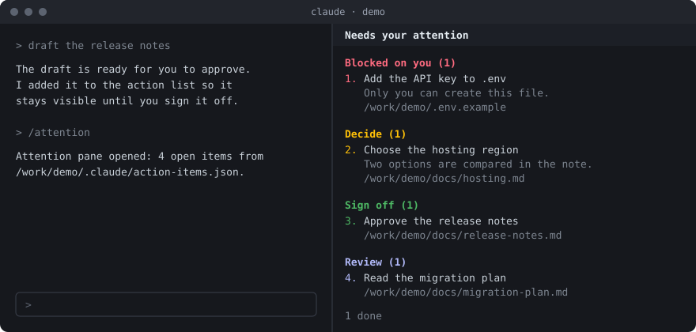
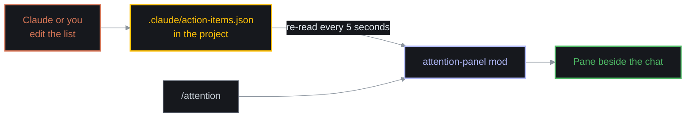
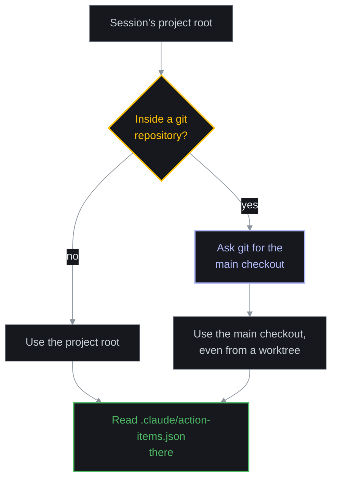

# attention-panel

A Claude Code mod that keeps a pane beside the chat listing what is waiting on you in the current project: things only you can do, decisions to make, work to sign off, and things to review. Where Claude has a recommendation for an item, the pane shows it with **Accept** and **Reject** buttons. It also adds the `/attention` command.

Long sessions bury the moments where Claude needs you. This pane keeps them in one place until you deal with them.



*An illustration of the layout with made-up items, not a screenshot.*

- [How it works](#how-it-works)
- [Requirements](#requirements)
- [Step-by-step guide](#step-by-step-guide)
- [File format](#file-format)
- [Options](#options)
- [Troubleshooting](#troubleshooting)
- [What the mod touches](#what-the-mod-touches)
- [Disclaimer](#disclaimer)
- [License](#license)

## How it works

The mod reads a JSON file in your project and draws its open items. Claude (or you) edits the file; the pane re-reads it every five seconds. When you press Accept or Reject on a recommendation, the mod writes your answer onto that item in the file and tells Claude.



The diagram colours match the pane: orange for Claude, amber for a decision, blue for the mod's own steps, green for what you end up seeing.

Each project has its own list. If the session is in a git worktree, the mod reads the list from the main checkout, so a project has one list wherever the session happens to be:



## Requirements

- Claude Code with support for mods (hooks modules). This mod was written against Claude Code 2.1.311. The mod API is early access and may change between releases.
- A terminal session to run the install command. Once installed at user scope the mod also loads in the desktop app.
- `git` on the path, only if you want the worktree behaviour. Without it the mod uses the session's project root.

## Step-by-step guide

### 1. Install the mod

At the prompt of a terminal session:

```
/plugin install attention-panel --marketplace w22l/claude-code-attention-panel
```

Or from a shell:

```
claude plugin install attention-panel --marketplace w22l/claude-code-attention-panel
```

In the desktop app, where `/plugin` does not run: click **+** next to the prompt box, then **Plugins**, **Add marketplace** with `w22l/claude-code-attention-panel`, then **Add plugin**.

You will be asked, in order:

1. `Add marketplace?` Answer `y`.
2. A scope. Choose **user** to have the pane in every project, or **project** for this one only.
3. The mod's one option, the path of the list file. Press Enter to keep the default.

When you see `Installed attention-panel. Plugin is now active.`, it is running. No restart is needed.

### 2. Create the list for a project

In the project's root folder, create `.claude/action-items.json` with an empty list:

```json
[]
```

Or start with one item:

```json
[
  {
    "id": "release-notes",
    "kind": "sign-off",
    "title": "Approve the release notes",
    "detail": "Draft is ready; nothing ships until this is approved.",
    "path": "/path/to/project/docs/release-notes.md",
    "since": "2026-01-15"
  }
]
```

If the file does not exist yet, the pane says so and shows the exact path it is looking for, which is the quickest way to check you put it in the right place.

### 3. Open the pane

Type:

```
/attention
```

The pane opens and the command reports how many items are open and which file they came from. On a wide terminal the pane also opens by itself when a session starts; on a narrow one, use the command.

### 4. Have Claude keep the list current

The pane is only as good as the list. Add this to the project's `CLAUDE.md` so Claude maintains it without being asked:

```
Keep `.claude/action-items.json` current. Add an item whenever something needs me:
a decision, a sign-off, a review, or a step only I can do. Give each item a kind
(blocked, decision, sign-off or review), a one-line title, a short detail, and the
full path of the file to look at. Set `done` to true when it is resolved; do not
delete resolved items.
```

### 5. Resolve items

When something is dealt with, set `"done": true` on the item (or tell Claude it is done and let it update the file). The item leaves the open groups and is counted on the `N done` line at the bottom. Keeping resolved items in the file gives you a record; delete them whenever you want a clean slate.

### 6. Answer Claude's recommendations with a click

When Claude has a view on an item, it adds a `recommendation` to it. The pane then shows the recommendation under the item with two buttons:

```
2. Choose the hosting region
   Two options are compared in the note.
   /path/to/project/docs/hosting.md
   Claude recommends: the nearer region.
   [ Accept ]  [ Reject ]
```

Click a button (or move the focus to it and press Enter). Three things happen:

1. The mod writes your answer onto the item in the list file: `"response": "accepted"` or `"rejected"`, with the time.
2. The buttons are replaced by a line recording your answer, for example `You accepted: the nearer region.`
3. The mod sends Claude a short prompt naming the item and your answer, so Claude acts on it straight away and then marks the item done.

Rejecting does not tell Claude what you want instead; say that in the chat. If you would rather answer without Claude starting a turn, turn off the **Tell Claude when you answer** option: your answer is still saved in the file, and Claude sees it the next time it reads the list.

To have Claude offer recommendations, extend the `CLAUDE.md` snippet from step 4 with:

```
When you have a view on an item, put it in the item's `recommendation` field as one
short sentence. When an item has a `response` of accepted or rejected, act on it:
carry out an accepted recommendation, ask what I want for a rejected one, then set
`done` to true.
```

### 7. Use it in another project

Nothing to install again if you chose user scope. Repeat steps 2 and 4 in the other project. Each project's pane shows only that project's list.

## File format

The file is a JSON array. Each item is an object:

| Field | Required | Meaning |
|---|---|---|
| `id` | yes | Stable identifier, unique within the file |
| `kind` | yes | One of `blocked`, `decision`, `sign-off`, `review` |
| `title` | yes | One line saying what is needed |
| `detail` | no | One or two sentences of context |
| `path` | no | The file or folder to look at. A full path is easiest to find from anywhere |
| `since` | no | The date the item was raised |
| `done` | no | `true` removes the item from the open groups and counts it as done |
| `recommendation` | no | Claude's proposed answer, one short sentence. Shown with Accept and Reject buttons until answered |
| `response` | written by the mod | `accepted` or `rejected`, set when you press a button |
| `respondedAt` | written by the mod | When you answered, as an ISO timestamp |

The pane groups open items by kind, in this order:

| Kind | Heading in the pane | Heading colour | Use it for |
|---|---|---|---|
| `blocked` | Blocked on you | Error colour (red in the default themes) | Work that cannot continue until you act |
| `decision` | Decide | Warning colour (amber) | A choice that is yours to make |
| `sign-off` | Sign off | Success colour (green) | Finished work waiting for your approval |
| `review` | Review | Suggestion colour (blue) | Something worth reading, with no deadline |

The colours are Claude Code theme colours, so they follow whichever theme you use. Open items are numbered down the pane, across the groups, so you can refer to one by number ("do item 3"). A long title, detail or path wraps under its own text, clear of the number.

A complete example:

```json
[
  {
    "id": "api-key",
    "kind": "blocked",
    "title": "Add the API key to .env",
    "detail": "Only you can create this file.",
    "path": "/path/to/project/.env.example",
    "since": "2026-01-15"
  },
  {
    "id": "hosting-region",
    "kind": "decision",
    "title": "Choose the hosting region",
    "detail": "Two options are compared in the note.",
    "path": "/path/to/project/docs/hosting.md",
    "since": "2026-01-15"
  },
  {
    "id": "release-notes",
    "kind": "sign-off",
    "title": "Approve the release notes",
    "path": "/path/to/project/docs/release-notes.md",
    "since": "2026-01-16"
  },
  {
    "id": "migration-plan",
    "kind": "review",
    "title": "Read the migration plan",
    "path": "/path/to/project/docs/migration-plan.md",
    "since": "2026-01-16"
  },
  {
    "id": "logo",
    "kind": "decision",
    "title": "Pick a logo",
    "done": true
  }
]
```

An item with a `kind` outside the four values is not shown. If the file is not a valid JSON array, the pane says so and shows the file's path.

## Options

| Option | Default | Meaning |
|---|---|---|
| Action items file (`file`) | `.claude/action-items.json` | Where the list lives. A path relative to the project root, or an absolute path |
| Tell Claude when you answer (`tellClaude`) | on | After you accept or reject a recommendation, send Claude a short prompt so it acts at once. Off: the answer is only saved in the file |

Change them in the plugin's settings in the config menu. Use a relative path to give every project its own list at the same place, for example `docs/action-items.json`. An absolute path points every project at one shared list.

## Troubleshooting

| What you see | Likely cause | What to do |
|---|---|---|
| The pane does not appear at start | The terminal is too narrow for a pane to open unasked | Run `/attention`, or widen the terminal |
| "No action list for this project yet" | The file is missing at the path shown | Create the file at exactly that path, or change the `file` option |
| The pane shows a different project's items | The `file` option is an absolute path | Set it back to a relative path |
| In a worktree the pane shows the main checkout's list | Intended: one list per project | Set an absolute path if you really want a per-worktree list |
| An item is missing | Its `kind` is not one of the four values, or `done` is `true` | Correct the item |
| "The action list is not a valid JSON array" | A syntax error, or the top level is not an array | Fix the file; the pane refreshes within five seconds |
| A recommendation shows no buttons | The item already has a `response`, or `done` is `true` | Remove `response` from the item to ask again |
| Pressing a button says the list could not be updated | The file changed to invalid JSON, or is not writable | Fix the file and press again |
| `/attention` is not recognised | The mod is not installed or not active in this session | Run the install command again and check the scope |

## What the mod touches

- It reads one file: the action list.
- It writes to that same file, and only when you press Accept or Reject: it sets `response` and `respondedAt` on the one item and rewrites the file with two-space indentation. It never writes at any other time and touches no other file.
- When you press a button it submits one prompt to Claude (unless you turn that option off). The prompt carries only the item's `id` and your answer, never the item's title, detail or recommendation text, so nothing written in the file is passed to Claude as if you had typed it.
- It runs one command, `git rev-parse --git-common-dir`, in the project root, to find the main checkout.
- It makes no network requests.
- It registers one command (`/attention`) and one pane.

The whole mod is one short file, [`hooks/register.tsx`](hooks/register.tsx). Read it before installing; it takes two minutes.

## Disclaimer

This software is provided "as is", without warranty of any kind. Use it at your own risk. The author accepts no responsibility or liability for any loss, damage or other consequence arising from its use, and offers no support, maintenance or guarantee that it will keep working with future versions of Claude Code. See the [LICENSE](LICENSE) for the full terms.

This is an independent project. It is not affiliated with, endorsed by or supported by Anthropic. "Claude" and "Claude Code" are trademarks of Anthropic.

## License

[MIT](LICENSE)
