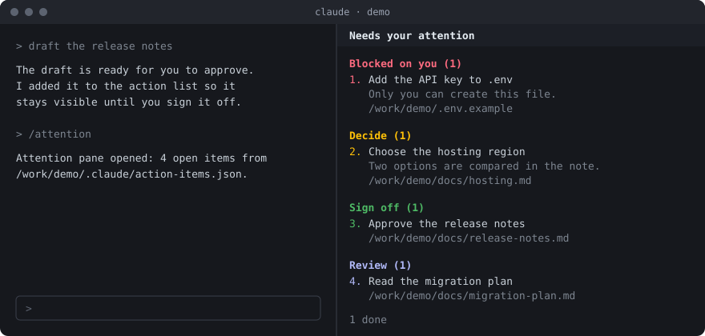
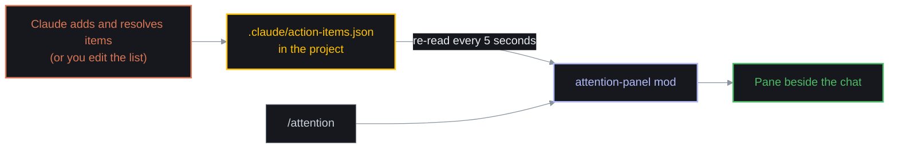
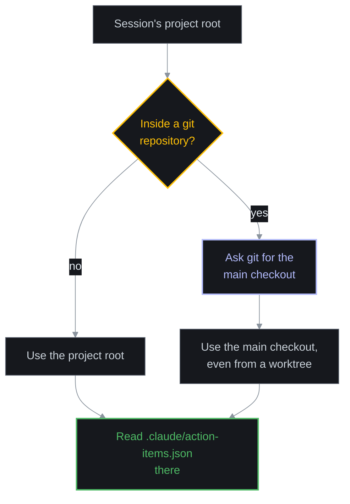

# attention-panel

A Claude Code mod that keeps a pane beside the chat listing what is waiting on you in the current project: things only you can do, decisions to make, work to sign off, and things to review. You answer in the pane, in the form the question needs: a yes or a no, one of several options, several options at once, or a line you type. It also adds the `/attention` command.

Long sessions bury the moments where Claude needs you. This pane keeps them in one place until you deal with them.

The list keeps itself: the mod tells Claude about it in every project, gives Claude two tools to add and resolve items, and flags any answer that asks you for something without listing it. The status line shows how many items are open even when the pane is closed.



*An illustration of the layout with made-up items, not a screenshot.*

- [How it works](#how-it-works)
- [Requirements](#requirements)
- [Step-by-step guide](#step-by-step-guide)
- [File format](#file-format)
- [Options](#options)
- [Troubleshooting](#troubleshooting)
- [What the mod touches](#what-the-mod-touches)
- [Disclaimer](#disclaimer)
- [License](#license)

## How it works

The mod reads a JSON file in your project and draws its open items. Claude (or you) edits the file; the pane re-reads it every five seconds. When you answer an item in the pane, the mod writes your answer onto that item in the file and tells Claude.



Claude is told about the list in its system prompt and has two tools for it, so the left-hand box happens without any setup. If an answer asks you for something and the list did not change, the pane flags it.

The diagram colours match the pane: orange for Claude, amber for a decision, blue for the mod's own steps, green for what you end up seeing.

Each project has its own list. If the session is in a git worktree, the mod reads the list from the main checkout, so a project has one list wherever the session happens to be:



## Requirements

- Claude Code with support for mods (hooks modules). This mod was written against Claude Code 2.1.311. The mod API is early access and may change between releases.
- A terminal session to run the install command. Once installed at user scope the mod also loads in the desktop app.
- `git` on the path, only if you want the worktree behaviour. Without it the mod uses the session's project root.

## Step-by-step guide

### 1. Install the mod

At the prompt of a terminal session:

```
/plugin install attention-panel --marketplace w22l/claude-code-attention-panel
```

Or from a shell:

```
claude plugin install attention-panel --marketplace w22l/claude-code-attention-panel
```

In the desktop app, where `/plugin` does not run: click **+** next to the prompt box, then **Plugins**, **Add marketplace** with `w22l/claude-code-attention-panel`, then **Add plugin**.

You will be asked, in order:

1. `Add marketplace?` Answer `y`.
2. A scope. Choose **user** to have the pane in every project, or **project** for this one only.
3. The mod's one option, the path of the list file. Press Enter to keep the default.

When you see `Installed attention-panel. Plugin is now active.`, it is running. No restart is needed.

### 2. The list for a project

You can skip this step: Claude creates the list the first time it needs you. To start one yourself, create `.claude/action-items.json` in the project's root folder with an empty list:

```json
[]
```

Or start with one item:

```json
[
  {
    "id": "release-notes",
    "kind": "sign-off",
    "title": "Approve the release notes",
    "detail": "Draft is ready; nothing ships until this is approved.",
    "path": "/path/to/project/docs/release-notes.md",
    "since": "2026-01-15"
  }
]
```

While the file does not exist, the pane says nothing is waiting and shows the exact path where the list will be, which is the quickest way to check a hand-made file is in the right place.

### 3. Open the pane

Type:

```
/attention
```

The pane opens and the command reports how many items are open and which file they came from. On a wide terminal the pane also opens by itself when a session starts; on a narrow one, use the command.

### 4. Claude keeps the list current

You do not need to set anything up. In every project where the mod is active:

- **Claude is told about the list.** The mod adds a short section to Claude's system prompt: add an item in the same turn in which you ask the person for something, and mark it done when it is settled. No line in `CLAUDE.md` is needed.
- **Claude has two tools for it.** `attention_add` adds an item (or updates the one with that id), with the kind of answer it needs, and `attention_resolve` marks one done. They create the file if it does not exist, keep every other entry as it is, and refuse to touch a file that is not valid JSON, so the list cannot be broken by a half-finished edit.
- **A missed ask is flagged.** When Claude's answer asks you for something (a question, "let me know", "I need your approval") and no item was added during that turn, the pane shows a line saying so, which stays until an item is added or you clear it, with two buttons: **Ask Claude to list it** sends Claude one short prompt to add what it asked for, and **Dismiss** clears the line. Turn on the *Ask Claude automatically* option to have the prompt sent without the press.
- **You see it without the pane.** The status line shows `3 waiting on you` while anything is open, and a new item raises a toast once.

The check for a missed ask is a list of phrases, in English and Chinese. It will sometimes flag an answer that only asked a rhetorical question; dismiss it. It is there for the case that matters: Claude waiting on you while the list says nothing is.

To turn the instruction and the tools off and keep the list yourself, switch off *Tell Claude to keep the list*. A line in `CLAUDE.md` still works either way:

```
Keep `.claude/action-items.json` current. Add an item whenever something needs me:
a decision, a sign-off, a review, or a step only I can do. Give each item a kind
(blocked, decision, sign-off or review), a one-line title, a short detail, and the
full path of the file to look at. Set `done` to true when it is resolved; do not
delete resolved items.
```

### 5. Resolve items

A **Done** button on a blocked item and a **Reviewed** button on a review item close it from the pane. Otherwise, when something is dealt with, Claude marks it done; you can also set `"done": true` on the item yourself. The item leaves the open groups and is counted on the `N done` line at the bottom. Keeping resolved items in the file gives you a record; delete them whenever you want a clean slate.

### 6. Answer in the pane

Each open item is drawn with the control its question needs. Claude says which when it adds the item; when it does not, the item's kind decides.

```
Decide (2)
1. Which checks should block a merge?                      2d
   [x] Lint   [ ] Unit tests   [x] Type check   [ ] E2E
   [ Submit 2 selected ]  [ Reply… ]

2. Choose the hosting region
   Claude recommends: Tokyo is nearest to most users.
   [ Tokyo (recommended) ]  [ Singapore ]  [ Frankfurt ]  [ Reply… ]

Blocked on you (1)
3. What should the API base URL be?
   > Type your answer                               (enter to send)

Sign off (1)
4. Approve the release notes
   [ Approve ]  [ Reject ]  [ Reply… ]
```

| The question | What you see | What a press does |
|---|---|---|
| Yes or no (`confirm`) | **Accept** / **Reject** under a recommendation. Otherwise worded for the kind: **Approve** / **Reject** on a sign-off; one button, **Done**, on a blocked item; one, **Reviewed**, on a review item | Answers at once. **Done** and **Reviewed** also close the item |
| One of several (`choice`) | A button per option; the one Claude would pick is marked `(recommended)` | Answers at once with that option |
| Several at once (`multi`) | A tick per option, with Claude's picks ticked to start, and **Submit N selected** | A press on an option ticks or unticks it; nothing is sent until Submit |
| Something only you know (`text`) | A field | Enter sends what you typed |

Every item that is not itself a field also has **Reply…**, which opens a field under it: use it when none of the buttons says what you mean ("neither, use Sydney"). **Cancel** puts the field away.

When you answer, three things happen:

1. The mod writes your answer onto the item in the list file: `response`, with `selected` (the options you picked) or `note` (what you typed), and the time.
2. The controls are replaced by a line recording it, for example `You chose: Lint, Type check`, with a **Change** button. Change takes the answer back and asks again; Claude is not told until you answer anew.
3. The mod sends Claude a short prompt naming the item, so Claude reads your answer from the file, acts on it and marks the item done.

If you would rather answer without Claude starting a turn, turn off the **Tell Claude when you answer** option: your answer is still saved in the file, and Claude sees it the next time it reads the list.

Before writing, the mod reads the file again and compares the item with what the pane drew. If the question was reworded or its options changed in between, nothing is written and a toast says `The question changed; look again.`, so a yes never lands on wording you did not see.

In the mobile app, which draws no fields yet, the buttons work and a `text` item says to answer in the chat.

### 7. Use it in another project

Nothing to install again if you chose user scope. Repeat steps 2 and 4 in the other project. Each project's pane shows only that project's list.

## File format

The file is a JSON array. Each item is an object:

| Field | Required | Meaning |
|---|---|---|
| `id` | yes | Stable identifier, unique within the file |
| `kind` | yes | One of `blocked`, `decision`, `sign-off`, `review` |
| `title` | yes | One line saying what is needed |
| `detail` | no | One or two sentences of context |
| `path` | no | The file or folder to look at. A full path is easiest to find from anywhere |
| `since` | no | The date the item was raised |
| `done` | no | `true` removes the item from the open groups and counts it as done |
| `recommendation` | no | Claude's proposed answer, one short sentence, shown above the controls until answered |
| `answer` | no | The answer the item needs: `{ "type": "confirm" \| "choice" \| "multi" \| "text", "options": [...], "recommended": [...] }`. See below |
| `response` | written by the mod | `accepted` or `rejected` for a yes or no; `answered` when you picked options or typed |
| `selected` | written by the mod | The options you picked, in the order they are listed |
| `note` | written by the mod | What you typed, exactly as typed |
| `respondedAt` | written by the mod | When you answered, as an ISO timestamp |

The pane groups open items by kind, in this order:

| Kind | Heading in the pane | Heading colour | Use it for |
|---|---|---|---|
| `blocked` | Blocked on you | Error colour (red in the default themes) | Work that cannot continue until you act |
| `decision` | Decide | Warning colour (amber) | A choice that is yours to make |
| `sign-off` | Sign off | Success colour (green) | Finished work waiting for your approval |
| `review` | Review | Suggestion colour (blue) | Something worth reading, with no deadline |

The colours are Claude Code theme colours, so they follow whichever theme you use. Open items are numbered down the pane, across the groups, so you can refer to one by number ("do item 3"). A long title, detail or path wraps under its own text, clear of the number. Beside the title the pane shows how long the item has waited, from `since`: `today`, `2d`, `3w`. A command you are asked to run is drawn in the colour the prompt uses for a shell line, so it stands out from the dim detail around it: anything between backticks, or a line written as `! …` up to its end.

The `answer` field:

| `type` | `options` | `recommended` |
|---|---|---|
| `confirm` | not used | not used |
| `choice` | 2 to 8 labels, each different, at most 60 characters | at most one of the labels |
| `multi` | the same | any of the labels |
| `text` | not used | not used |

Without an `answer`, an item with a `recommendation` gets **Accept** and **Reject**, whatever its kind, as in 0.4.0. Without either, a sign-off, a review and a blocked item get the buttons of their kind, and a decision gets **Reply…** alone. An `answer` that breaks the rules above (a hand edit, say) is passed over and the item is drawn the same way; `attention_add` refuses such an answer and says what to put right. It also refuses an `id` that is not 1 to 64 letters, digits, dots, dashes or underscores.

A complete example:

```json
[
  {
    "id": "api-key",
    "kind": "blocked",
    "title": "Add the API key to .env",
    "detail": "Only you can create this file.",
    "path": "/path/to/project/.env.example",
    "since": "2026-01-15"
  },
  {
    "id": "hosting-region",
    "kind": "decision",
    "title": "Choose the hosting region",
    "detail": "Three options are compared in the note.",
    "path": "/path/to/project/docs/hosting.md",
    "recommendation": "Tokyo is nearest to most users.",
    "answer": { "type": "choice", "options": ["Tokyo", "Singapore", "Frankfurt"], "recommended": ["Tokyo"] },
    "since": "2026-01-15"
  },
  {
    "id": "merge-checks",
    "kind": "decision",
    "title": "Which checks should block a merge?",
    "answer": { "type": "multi", "options": ["Lint", "Unit tests", "Type check", "E2E"], "recommended": ["Lint", "Type check"] },
    "since": "2026-01-15"
  },
  {
    "id": "release-notes",
    "kind": "sign-off",
    "title": "Approve the release notes",
    "path": "/path/to/project/docs/release-notes.md",
    "since": "2026-01-16"
  },
  {
    "id": "migration-plan",
    "kind": "review",
    "title": "Read the migration plan",
    "path": "/path/to/project/docs/migration-plan.md",
    "since": "2026-01-16"
  },
  {
    "id": "logo",
    "kind": "decision",
    "title": "Pick a logo",
    "done": true
  }
]
```

Nothing in the file is dropped silently:

- An item with a `kind` outside the four values is shown last, under **Other**.
- A field of the wrong type (a number where a sentence should be) is left out of the drawing, and written back as it was.
- An entry without an `id` or a `title` cannot be shown; the pane counts such entries on a line of its own.
- When two items share an `id`, both are shown, the pane says so, and only the first has controls.
- If the file stops being a valid JSON array (a half-finished edit, say), the pane says so and keeps showing the last list it could read until the file is repaired.
- If the file does not exist, the pane says nothing is waiting and where the list will be created.

## Options

| Option | Default | Meaning |
|---|---|---|
| Action items file (`file`) | `.claude/action-items.json` | Where the list lives. A path relative to the project root, or an absolute path |
| Tell Claude when you answer (`tellClaude`) | on | After you answer an item in the pane, send Claude a short prompt so it acts at once. Off: the answer is only saved in the file |
| Tell Claude to keep the list (`instructClaude`) | on | Add the instruction to Claude's system prompt and register the `attention_add` and `attention_resolve` tools. Off: the mod only reads the list |
| Ask Claude automatically when an ask is missed (`autoCapture`) | off | When an answer asks you for something and the list did not change, send Claude the prompt to list it without waiting for you to press the button. Costs one short extra turn each time it fires |

Change them in the plugin's settings in the config menu. Use a relative path to give every project its own list at the same place, for example `docs/action-items.json`. An absolute path points every project at one shared list.

## Troubleshooting

| What you see | Likely cause | What to do |
|---|---|---|
| The pane does not appear at start | The terminal is too narrow for a pane to open unasked | Run `/attention`, or widen the terminal |
| "Nothing is waiting on you" with a path under it | The list does not exist yet | Nothing to do: Claude creates it at that path the first time it needs you. Change the `file` option to keep it elsewhere |
| "Claude asked you for something that is not in this list" | An answer contained a question or a request and no item was added in that turn | Press **Ask Claude to list it**, or **Dismiss** if it was not a real ask |
| Claude never adds items | *Tell Claude to keep the list* is off, or the installed version is older than 0.4.0 | Turn the option on; update the plugin |
| The pane shows a different project's items | The `file` option is an absolute path | Set it back to a relative path |
| In a worktree the pane shows the main checkout's list | Intended: one list per project | Set an absolute path if you really want a per-worktree list |
| An item is missing | `done` is `true`, or the entry has no `id` or `title` (the pane then shows "1 entry could not be shown") | Correct the item |
| "The action list is not a valid JSON array" | A syntax error, or the top level is not an array | Fix the file; the pane refreshes within five seconds. Until then it shows the last list it could read |
| An item shows no controls | It is already answered (press **Change** to answer again), or another item above it has the same `id` | Press Change; give each item its own `id` |
| `The question changed; look again.` | The item was reworded, or its options changed, between the pane drawing it and your press | Read the item as it now stands and answer again |
| A `text` item says "Answer this one in the chat." | The mobile app draws no fields yet | Answer in the chat, or on another device |
| An item has only **Reply…** | It is a decision with no recommendation and no `answer` | Reply in words; ask Claude to give options next time |
| Claude edits the file itself instead of calling `attention_add` | The mod's tools did not connect when the session started (seen on a start-up where many MCP servers timed out together) | Nothing is lost: the pane reads the file whoever wrote it. Restart the session to get the tools back |
| Pressing a button says the list could not be updated | The file changed to invalid JSON, or is not writable | Fix the file and press again |
| `/attention` is not recognised | The mod is not installed or not active in this session | Run the install command again and check the scope |

## What the mod touches

- It reads one file: the action list, every five seconds and at the start and end of each turn. A file that has not changed costs that one read and nothing more.
- It writes to that same file in two cases, and touches no other file:
  - when you answer an item in the pane: it sets `response`, `respondedAt` and, as the answer has them, `selected` or `note` on the one item (and `done` for a press on Done or Reviewed); a press on Change removes them again;
  - when Claude calls `attention_add` or `attention_resolve`: it adds, updates or marks done the one item named. Every other entry, and every field it does not know, is written back unchanged. These two tools run without a permission prompt: the mod answers them itself, and the one list file is all they can change. Changes to the file take turns, so two of them at once cannot overwrite each other.
- It adds one section to Claude's system prompt, describing the list and when to update it. The section names the file path and nothing from the file.
- It reads the text of Claude's final answer of each turn, in memory, to check it against a list of asking phrases. The answer is not stored, logged or sent anywhere.
- It submits a prompt to Claude in two cases (three with *Ask Claude automatically* on): when you answer an item in the pane, and when you press **Ask Claude to list it**. Each prompt is fixed text plus, for an answer, the item's `id` and one of the words `accepted`, `rejected` or `answered`. No title, detail, recommendation or option is ever included, and neither is what you typed in a field: Claude reads the answer from the file. So nothing written in the file or by Claude is passed back to Claude as if you had typed it.
- It sets one status line entry and raises a toast when a new item appears. The toast shows the item's title.
- It runs one command, `git rev-parse --git-common-dir`, in the project root, once per session, to find the main checkout.
- It makes no network requests.
- It keeps what you have begun and not sent (ticks, an open reply field) in the session's memory, not in the file.
- It registers one command (`/attention`), one pane and two tools.

The whole mod is one file, [`hooks/register.tsx`](hooks/register.tsx). Read it before installing.

## Disclaimer

This software is provided "as is", without warranty of any kind. Use it at your own risk. The author accepts no responsibility or liability for any loss, damage or other consequence arising from its use, and offers no support, maintenance or guarantee that it will keep working with future versions of Claude Code. See the [LICENSE](LICENSE) for the full terms.

This is an independent project. It is not affiliated with, endorsed by or supported by Anthropic. "Claude" and "Claude Code" are trademarks of Anthropic.

## License

[MIT](LICENSE)
